<div align="center">

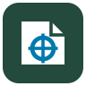

# Sheetfit

**A Canva-style editor for sublimation and DTF print sheets. Every design printed whole, at its true size.**

[](https://github.com/satyaidk/Sheetfit/actions/workflows/ci.yml)


[](LICENSE)

[Overview](#overview) · [Features](#key-features) · [Architecture](#architecture) · [Getting started](#getting-started) · [Testing](#testing--quality) · [Design decisions](#design-decisions-adrs) · [Docs](#documentation) · [Status](AGENTS.md)

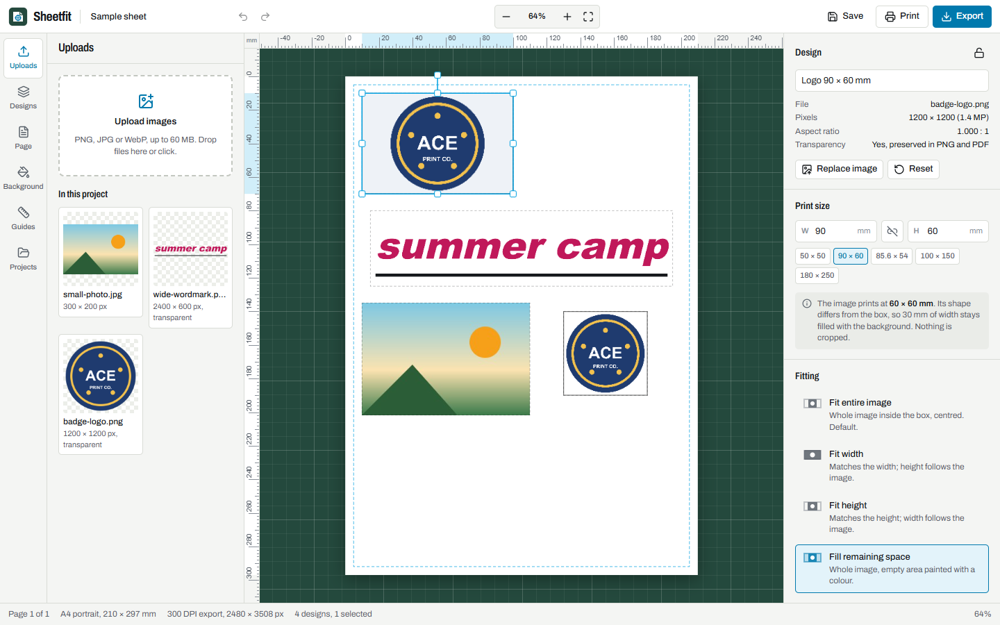

</div>

## Overview

Sheetfit is a browser-based layout editor for sublimation and DTF printing. You pick what you are printing (an 11 oz mug wrap, a 20 oz tumbler, a left-chest transfer, or any custom size), drop images into product templates at their real print size, and arrange them on a sheet: A4, A3, US Letter, US Legal, A3+ or a 22 in DTF gang sheet. The output is a print-ready PDF, PNG or JPEG in which every design has exactly that physical size and position, mirrored for sublimation transfers and left unmirrored for DTF.

Clicking a product starts a design for that product on the sheet it needs, with a live preview of the product docked beside the canvas that updates as you work. Switching to another product asks whether to save or discard the current design (or add the product to the current sheet instead), so designs for different products are never merged by accident. A project can also have several pages, each with its own sheet, for gang sheets that mix sizes. Every product can be inspected as an interactive 3D model at its real size, with the design on it, in any blank colour.

The editor follows the structure of Canva's: an icon rail with one panel, a quick-actions bar that follows the selection, a floating pill next to the selection, a right-click menu, and a zoom footer. It adds the print-specific tools Canva does not have, based on [published research](reports/Canva%20UX%20and%20print%20size%20catalogue.md): live millimetre gaps while dragging, effective-DPI badges, a pre-print check, and a sheet-usage readout.

General-purpose design tools usually treat a sized image frame as a crop window (`object-fit: cover`), which silently cuts off the edges of a logo when its proportions differ from the frame. Sheetfit does the opposite by default: the whole image is fitted inside the requested box, the proportions are preserved, and any leftover space is measured and reported. Distortion and cropping exist, but only as explicit, opt-in actions.

Everything runs in the browser. There is no account, no server and no upload: images and saved projects stay in the user's browser (IndexedDB).

## Key features

- **Non-cropping fitting engine.** Six modes: fit entire image (default), fit width, fit height, fill remaining space with a colour, manual scale, and stretch. Stretch requires confirmation; cropping is a separate switch that is off by default and never alters the source file.
- **Physical units throughout.** The document model is millimetres. Inputs accept mm, cm, inches or pixels (at the export DPI), with an aspect-ratio lock that derives the other side from the image.
- **52 product templates.** Mugs, tumblers, cans, bottles, coasters, mouse pads, ornaments, tags, cards, panels, puzzles, plates, and T-shirt, hoodie, kids, cap and tote placements. Sizes come from blank suppliers and DTF placement guides, each with its source and a confidence level, and stay editable. Each card shows an original illustration of the product in a blank colour with a sample design on it, and a new mix of designs appears every time the panel opens.
- **A design per product.** Clicking a template opens a new design on the smallest sheet that holds it, with the empty product box zoomed to fill the canvas and labelled with its exact size. If the current design has work in it, a dialog offers Save and open, Discard and open, Add to this sheet, or Cancel. The "+" on each card adds the product to the current sheet directly.
- **Product boxes.** A template becomes an empty box at its print size (with bleed for flat goods and seam overlap for wraps); drop an image onto it, or pick one from Uploads, and it is fitted whole.
- **Live product preview.** A preview docked on the canvas shows the selected product (or the first one on the page) with the design on it, in the chosen blank colour, and stays visible while designing.
- **Sheet size dropdown.** A grouped dropdown (paper, DTF gang sheets and rolls, custom) in the header, the Sheet panel and the start dialog, with each sheet's size and typical use. If designs end up off a smaller sheet, a notice offers Undo.
- **Pages, each with its own sheet.** A4, US Letter, US Legal, A3, A3+ and 22 in DTF gang sheets, or a custom size, per page. A template goes into the first free spot on the current page; one that is too big, or printed with the other process, gets a new page with the smallest sheet that holds it, so other designs never change sheet. Pages can be added, duplicated and deleted from the page strip, and designs moved between them from the right-click menu.
- **Realistic product pictures.** Every card, list and dialog shows a render of the product's own 3D model with a sample design, not a line drawing; small placements (left chest, sleeve, pocket, neck label, cap front) add a detail inset. The editor's live preview shows your design on the 3D model as you work.
- **3D model of every product.** All 52 templates have a procedural 3D model at real size (three.js): glazed mugs with handles, steel tumblers with lids and straws, glass cans, bottles, bevelled coasters with cork backs, tags on rings, aluminium panels, real garment T-shirts (crew neck with a ribbed collar, set-in sleeves, seams, hems, fabric with an inside, folds; see [the T-shirt model](docs/models/tshirt.md)), padded hoodies with drape, caps with the print on the crown, totes and flags. The design is applied the way each process prints (sublimation dye blends into the blank, DTF sits on top as a film). Drag to turn, scroll to zoom, jump to the front, side or back, go full screen, auto-rotate, save an image; the backdrop adapts to the blank colour for contrast. three.js loads only when a 3D view opens.
- **Large product previews.** See a product box on the mug, tumbler, shirt, cap or tote in any blank colour, turn a wrap around 360°, show the print area, and download the preview as a 1600 × 1600 px PNG for a customer. Sublimation previews blend the design with the blank colour (the dye is transparent) and warn on dark blanks; DTF previews print opaque.
- **Sample designs.** Original emblems and patterns generated in the browser (no network, free to print), redrawn at the shape of the selected box. Fill a product box with one click from the Designs panel or the properties panel.
- **Processes.** Sublimation turns output mirroring on; DTF turns it off.
- **Canva-style editing.** Round and pill resize handles, magenta snap guides, live gap measurements in mm, space-drag panning, Shift+2/3 zoom to sheet or selection, a layers panel with drag-to-reorder, flip, distribute, group, lock, and Canva's keyboard shortcuts (`?` shows them all).
- **Sheet tools.** Portrait and landscape, per-side margins, printable-area guides, millimetre rulers, an optional grid, crop marks, and an option that keeps designs inside the margins.
- **Multiple designs per sheet.** Duplicate, copy and paste, multi-select, group, align, repeat a design in a grid ("fill sheet"), and auto-arrange mixed sizes without overlap. Layouts never resize anything; if designs do not fit, the editor says how many were left over and which change (orientation, spacing, margins) would help, checked by re-running the layout.
- **Print-quality checks.** Effective DPI for each design at its printed size in the quick-actions bar and on the canvas, plus a pre-print check before export that lists designs off the sheet, in the margins, overlapping, low-resolution, stretched or still empty. Click an issue to select the design.
- **Exports.** One PDF with a page per project page, each at its exact sheet size (A4 is 595.276 × 841.890 pt), with designs placed as vectors and PNG/JPEG sources embedded without recompression; PNG with transparency and JPEG at 150, 300 or 600 DPI with the DPI written into the file metadata, one file per page. All pages or only the current one.
- **Browser printing at actual size.** A print-only render with one CSS named `@page` per sheet size and zero margins, and step-by-step guidance for the print dialog.
- **Landing page with real prints.** Photos of sublimated and DTF-printed products (Unsplash and Pexels, credited), a four-step "how it works" with an interactive product and colour preview, and the facts that separate sublimation from DTF.
- **Local projects.** Save, reopen, duplicate and delete projects in IndexedDB, including the original image files, or export a portable `.sheetfit` project file to continue on another computer.

## Demo

| 3D: 11 oz mug | 3D: T-shirt, full front | 3D: every product |
| --- | --- | --- |
| 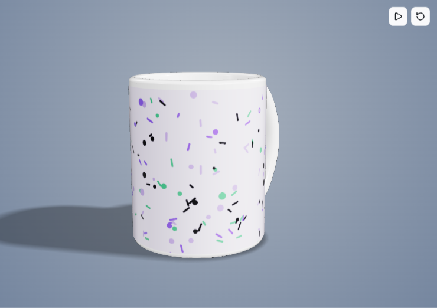 | 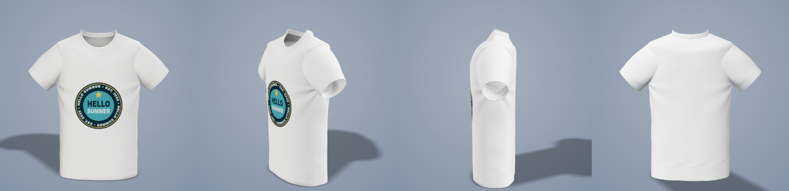 | 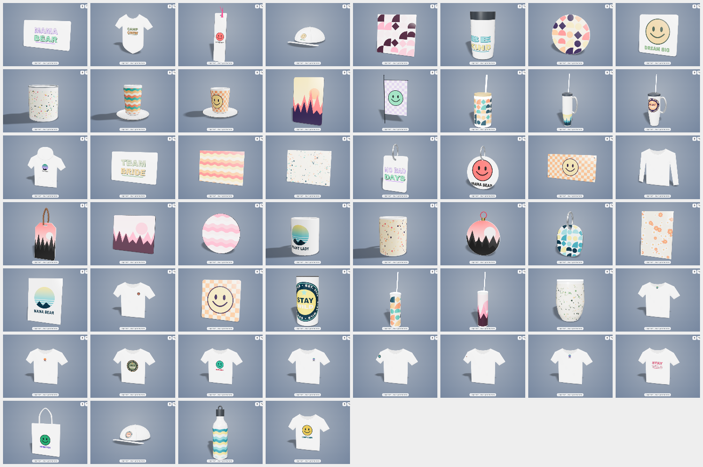 |

| Live preview while designing | Switching product asks first | Sheet size dropdown |
| --- | --- | --- |
|  | 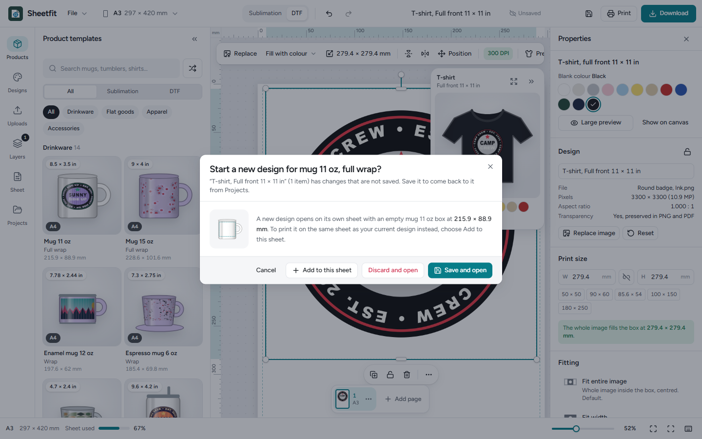 | 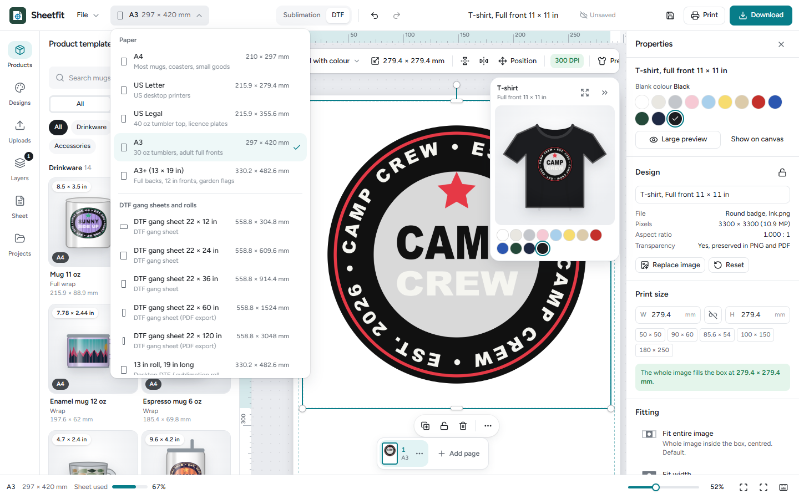 |

| Product templates | New product design | Large preview, tumbler turned |
| --- | --- | --- |
| 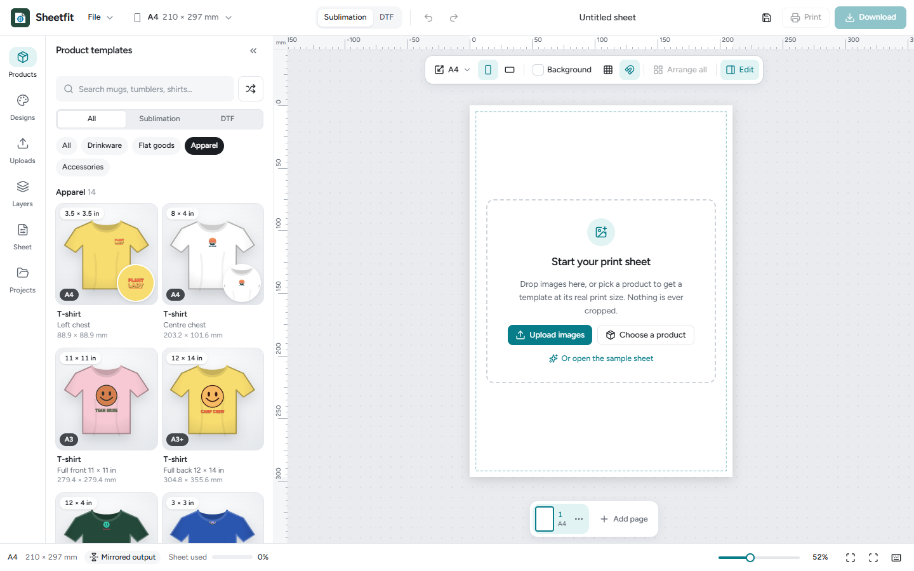 | 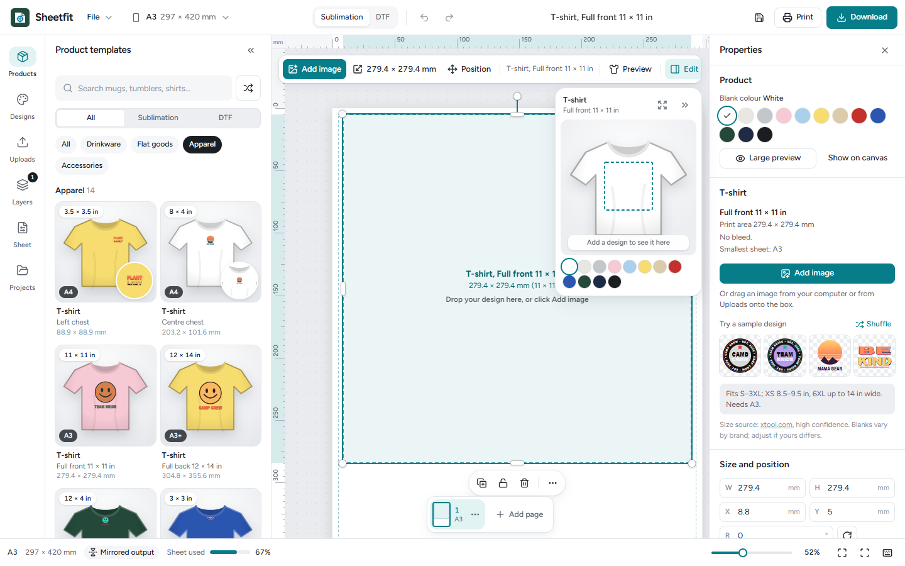 | 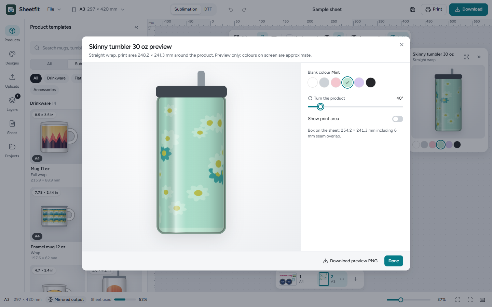 |

| Home page | How it works | Try the sheet |
| --- | --- | --- |
| 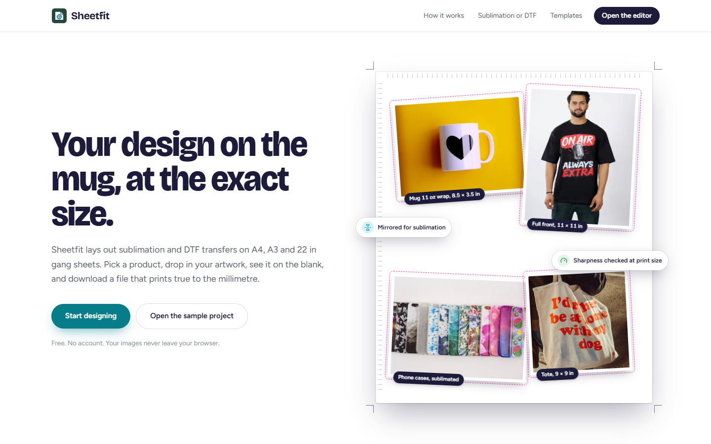 | 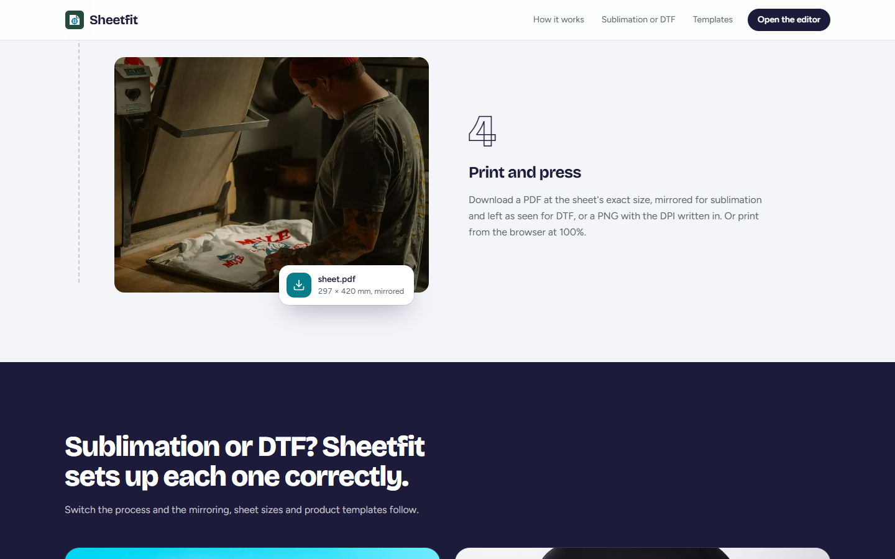 | 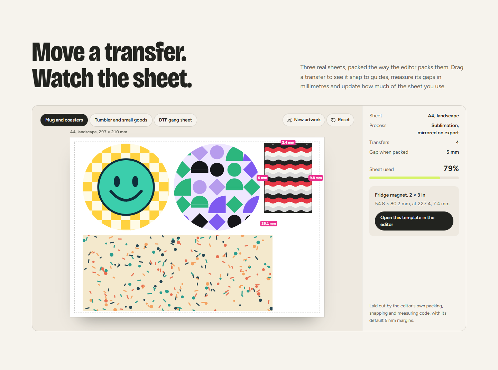 |

| Download every page | Pages | Mobile |
| --- | --- | --- |
| 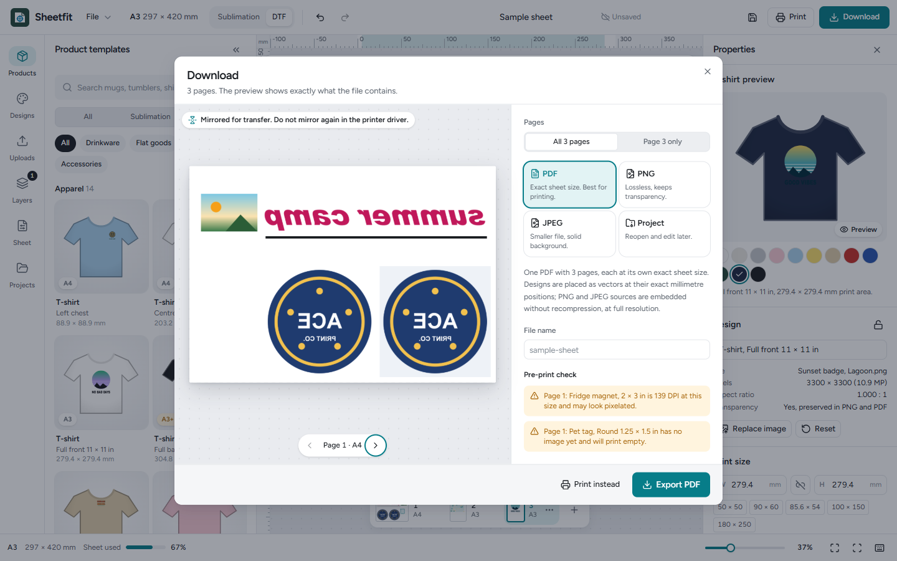 | 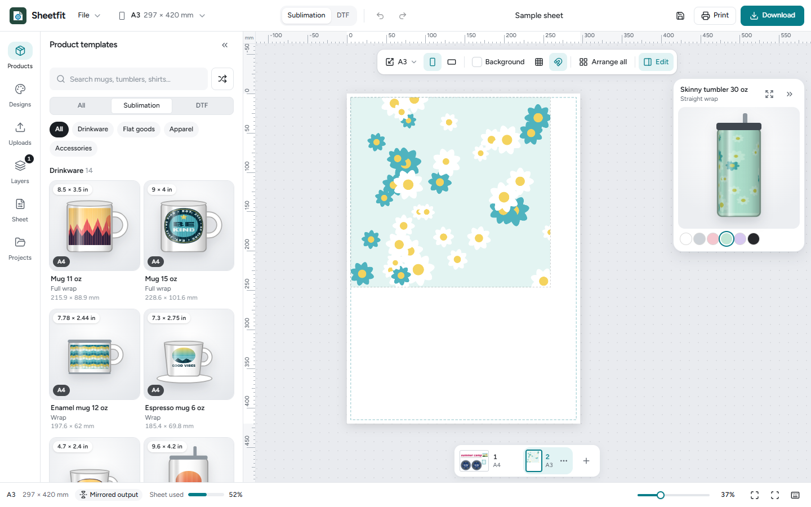 | 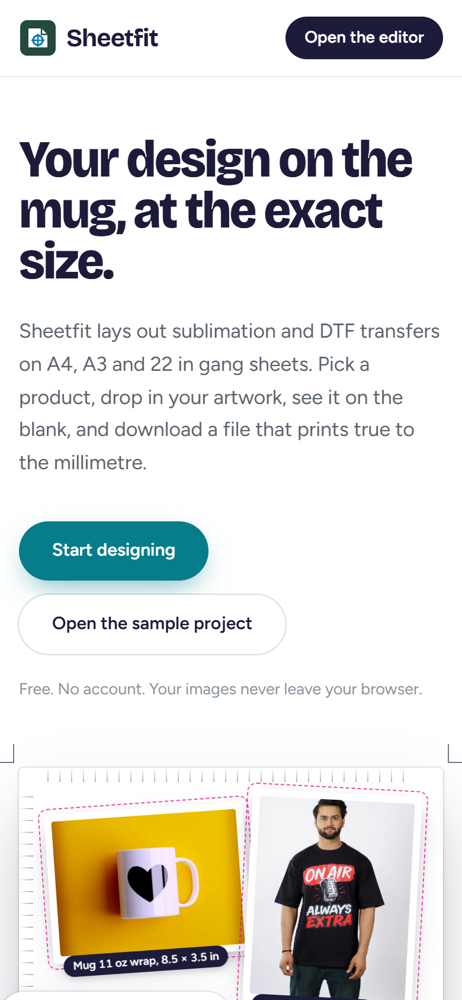 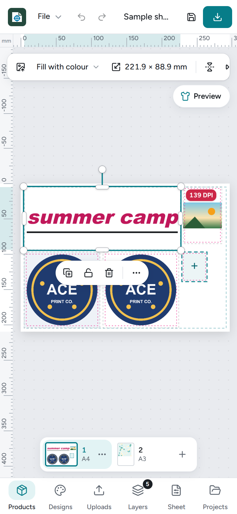 |

Run the app locally and open `/editor?sample` for the sample project. Page 1 (A4) holds an 11 oz mug wrap with a very wide wordmark, two coasters with a round logo, a magnet with a 300 × 200 px photo that triggers the low-resolution warning, and an empty pet-tag box. Page 2 (A3) holds a 30 oz tumbler wrap with a sample pattern on a mint blank.

## Architecture

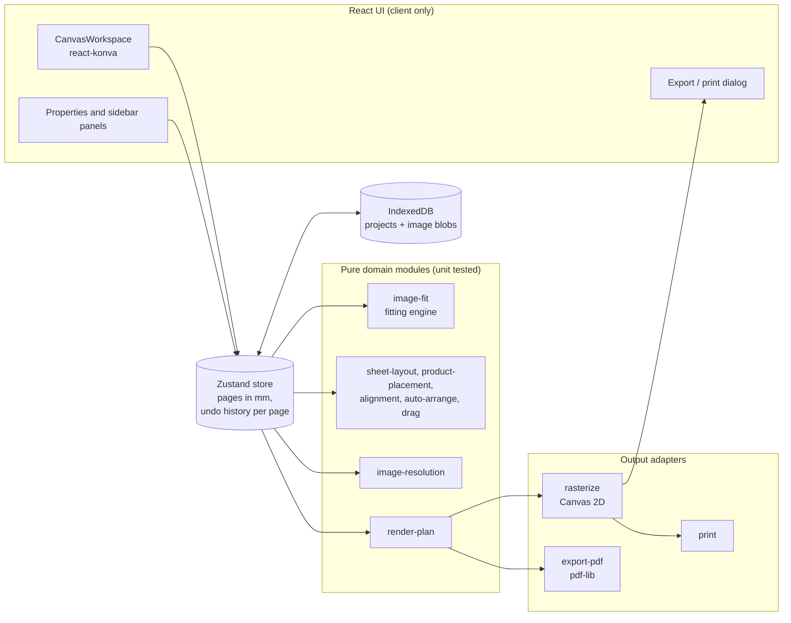

Three rules hold the design together:

1. **One coordinate system.** The document stores millimetres. Pixels and PDF points appear only at the edges, in [`coordinate-conversion.ts`](src/lib/layout/coordinate-conversion.ts), and rounding to whole pixels happens only when an export canvas is allocated.
2. **One render plan.** [`render-plan.ts`](src/lib/render/render-plan.ts) turns the document into plain data. The PNG, JPEG, PDF, print and preview paths all draw from it, so the export preview is the export.
3. **Pure rules, thin UI.** Fitting, layout, snapping, quality and export geometry are pure TypeScript with no React or DOM dependency, which is why they can be tested exhaustively in Node.

See [docs/design.md](docs/design.md) for the full design document.

## Getting started

### Prerequisites

- Node.js 20.9 or newer (developed on Node 24)
- npm 10 or newer
- A Chromium-based browser, Firefox or Safari

### Install

```bash
git clone https://github.com/satyaidk/Sheetfit.git
cd Sheetfit
npm ci
```

### Configure

No configuration or environment variables are required. The app has no backend and makes no network requests at runtime beyond loading its own assets.

### Run

```bash
npm run dev        # http://localhost:4000
npm run build      # production build
npm run start      # serve the production build
```

## Usage

1. Open `/editor`. On first visit, **What are you printing?** asks for the process (sublimation or DTF), the sheet, and optionally a starter product.
2. Open **Products** and click a template, such as **Mug 11 oz, full wrap** or **T-shirt, full front**. A new design opens on the sheet the product needs, with the empty box zoomed to fill the canvas and the live preview docked beside it. If your current design has work in it, you are asked to save it, discard it, or add the product to the current sheet instead. To build a gang sheet, use the **+** on a card: the product goes into the first free spot, or onto a new page with the right sheet if it does not fit.
3. Drop an image onto the box, drag one from **Uploads**, click **Add image** in the quick-actions bar, or pick a sample from **Designs**. The image is fitted whole; nothing is cropped.
4. Watch the live preview as you design. Pick a blank colour there, or open the large preview to turn a mug or tumbler around and download the preview.
5. For any other size, use **Custom size** in Products, or drop images straight onto the sheet. They are placed at their native size at 300 DPI.
6. Change the sheet from the dropdown in the header. Switch pages in the strip under the canvas (Page Up / Page Down). Arrange with drag (live gaps in mm), arrow keys (1 mm, Shift for 10 mm), the **Position** menu, **Arrange all**, or **Repeat on sheet** in the properties panel.
7. Check the DPI badge in the quick-actions bar, then click **Download** for PDF, PNG, JPEG or a `.sheetfit` file, or **Print**, for all pages or the current one. The pre-print check lists anything that would spoil the print, page by page.

Press `?` for every keyboard shortcut.

## Project structure

```text
src/
  app/                    Next.js App Router pages (landing, /editor)
  components/
    editor/               Shell: header, side rail and panels, canvas, quick bar, pill, inspector, footer, dialogs
    products/             Product templates, product mockups and previews, sample designs panel
    settings/             Measurement fields, size and fitting controls, page settings
    uploads/              Upload panel and thumbnails
    export/               Export and print dialog
    ui/                   shadcn/ui-style primitives on Radix
  lib/
    catalogue/            Sheets, the 52 product presets (sizes, bleed, sources), blank colours, sample designs
    image/                Fitting engine, resolution checks, file decoding
    layout/               Units, sheet geometry, product placement, alignment, snapping, gaps, auto-arrange
    render/               Render plan shared by every output
    export/               Canvas rasteriser, PDF builder, DPI metadata, pre-print check, printing
    storage/              IndexedDB persistence, .sheetfit files, migrations
    three/                3D product models, the T-shirt garment generator, fabric maps, textures
  store/                  Zustand editor store
  types/                  Document, image and project types
public/models/            tshirt.glb and its texture maps (generated)
scripts/                  T-shirt GLB export, product-picture renderer
tests/                    Vitest unit tests
docs/                     Design document, ADRs, learning path, images
reports/                  Research report behind the v0.2 redesign and catalogue
AGENTS.md                 Living project report: status, plan, file map, update log
```

## Testing & quality

```bash
npm run lint           # ESLint (Next.js core-web-vitals + TypeScript rules)
npm run typecheck      # tsc --noEmit, strict mode
npm test               # Vitest
npm run test:coverage  # Vitest with V8 coverage and thresholds
npm run check          # all of the above plus a production build
```

The suite has 196 tests across product pictures (one per template, detail crops for small placements), the home page's example sheets and editor links, 3D models (every product built and size-checked, print mapping, backdrop contrast for every blank colour), fitting, units, sheets, the product catalogue, product placement and free-spot search, product designs and the save-or-discard rules, pages with per-page history, layout, snapping, live gaps, distribution, auto-arrange, the render plan with mirroring and flips, single- and multi-page PDF export, print page rules, DPI metadata, the pre-print check, sample designs, blank colours, file validation, migrations, IndexedDB storage, project files and the editor store. It includes every scenario listed in the original specification, for example a square logo in a 90 × 60 mm box, an extremely wide logo, a low-resolution image at 300 DPI, A4 portrait and landscape PDFs, and an image placed at a known coordinate. A property-style test checks that no non-distorting mode ever places image pixels outside the box.

Coverage is measured over the domain, export and store layers (`src/lib`, `src/store`), excluding browser-only glue that needs a real DOM canvas: 93.0% of lines, 91.0% of statements and 80.4% of branches. CI enforces minimums of 80% lines, statements and functions and 65% branches.

Browser-only paths (landing page, Konva interaction, canvas export, file upload, IndexedDB round trip, printing, previews, 3D viewer, dialogs and dropdowns) were verified end to end in headless Chrome against the production build: 48 scripted checks for the whole app and 32 for the home page, all passing, with no console errors. A third script opens the 3D view of all 52 products and checks that each one renders. See [Evaluation](#evaluation).

## Evaluation

Measured in headless Chrome against `npm run build && npm run start`, on the sample sheet:

| Check | Result |
| --- | --- |
| PDF page size | 1 page, 595.276 × 841.890 pt = 210.000 × 297.000 mm |
| PNG export at 300 DPI | 2480 × 3508 px, pHYs chunk reads 300 DPI |
| Square logo in a 90 × 60 mm box | Prints at 60 × 60 mm, 15 mm spare each side, nothing cropped |
| Full-page PNG uploaded onto a 5 mm-margin sheet | Placed at 200 × 282.9 mm, whole, inside the 200 × 287 mm printable area |
| Drag, undo, typed sizes, save and reopen | Behave as expected; no console errors |
| `.sheetfit` export and re-import | Same designs restored with original image bytes |
| v0.2: sample sheet on A4 landscape | PDF 297.00 × 210.00 mm; PNG 3508 × 2480 px at 300 DPI; preview mirrored for sublimation |
| v0.2: switch to DTF, then undo | Mirroring turns off, then back on |
| v0.3: A4 page with a mug and a coaster, then add a 30 oz tumbler | Tumbler gets page 2 on A3 (297 × 420 mm); page 1 stays A4 landscape with its designs unchanged |
| v0.3: add a round coaster while on page 1 | Placed in a free spot on page 1, no new page |
| v0.3: download all pages as PDF | One PDF, 2 pages: 297.0 × 210.0 mm and 297.0 × 420.0 mm |
| v0.3: download all pages as PNG at 300 DPI | Two files: 3508 × 2480 px and 3508 × 4961 px |
| v0.3: print all pages | Two images with named `@page` rules of 297 mm × 210 mm and 297 mm × 420 mm |
| v0.3: product preview of the tumbler | Wrap drawn as 28 curved strips; colour, turn and print-area controls work; preview PNG is 1600 × 1600 px |
| v0.3: duplicate and delete pages, save and reopen | Page count and sheets restored; project list shows "2 pages" |
| v0.4: click a T-shirt card on an untouched design | Replaced without asking; A3 sheet; live preview docked; box at the top centre |
| v0.4: click a mug card after adding an image | Dialog asks first; Cancel changes nothing; Save and open saves the T-shirt design to Projects and opens the mug on its own sheet |
| v0.4: add a left-chest placement with "Add to this sheet" | Both placements on one DTF page; a sublimation-only mug would get its own page |
| v0.4: header dropdown to US Letter with a 30 oz tumbler wrap | Notice that designs are off the sheet; Undo restores A3 |
| v0.4: landing page | 18 images load, none broken; no horizontal overflow at 390 px |
| v0.6: home page at 1440, 1024, 768, 390 and 320 px | No horizontal overflow, no console errors; phone menu opens and closes with Escape |
| v0.6: product tiles and links | `/editor?product=tee-full-front&process=dtf` opens the T-shirt template on A3 with DTF selected; `?product=mug-11oz` opens the mug on A4; an unknown product opens the empty editor |
| v0.7: product pictures | 52 renders (720 px WebP with alpha) and 9 detail crops, 884 KB for the 52; editor cards load them with none broken |
| v0.7: live preview dock | Shows the sample's mug wrap on the 3D model (model and shadow cover 25.1 % of the dock canvas) |
| v0.7: 3D toolbar | Front, Side, Back, zoom and full screen present; Side view turns the model |
| v0.7: home page at 1440 and 390 px | No horizontal overflow, no console errors; the scroll story activates the step in view; FAQ answers open |
| v0.6: home page sheet demo | Arrow keys move a transfer 1 mm (Shift 10 mm); dragging shows guides and live gaps; the DTF gang sheet packs 12 transfers with a 6.35 mm gap |
| v0.2: fill an empty product box, save, reopen | Box filled through the inspector; all designs restored; no console errors |
| v0.5: open the 3D view of every product | 52 of 52 render a model (the model and its shadow cover 7.5 % to 27.2 % of the canvas); no console errors (software WebGL, about 13 s per product) |
| v0.5: 11 oz mug in white, then in black | Backdrop centre changes from blue-grey `#a8b1bd` (contrast 2.17 with white) to near-white `#f6f7f8` |
| v0.5: Save 3D image in the large preview | Downloads `skinny-tumbler-30-oz-straight-wrap-white-3d.png` |
| v0.5: Escape in the 3D viewer | Closes the viewer; the side panel behind it stays open |
| Mobile viewport (390 × 844) | No horizontal overflow |

## Design decisions (ADRs)

| ADR | Decision |
| --- | --- |
| [0001](docs/adr/0001-millimetres-as-the-document-unit.md) | Millimetres are the only unit stored in the document |
| [0002](docs/adr/0002-contain-by-default-never-crop.md) | Fit inside the box by default; distortion and cropping are opt-in |
| [0003](docs/adr/0003-shared-render-plan.md) | Every output draws from one shared render plan |
| [0004](docs/adr/0004-konva-for-the-editor-canvas.md) | Konva (react-konva) for interactive editing |
| [0005](docs/adr/0005-pdf-lib-vector-placement.md) | pdf-lib with vector placement for PDF export |
| [0006](docs/adr/0006-client-only-with-indexeddb.md) | Client-only app with IndexedDB persistence |
| [0007](docs/adr/0007-sheets-process-and-product-slots.md) | Sheets as data, process-driven mirroring, product slots |
| [0008](docs/adr/0008-pages-previews-and-sample-designs.md) | Pages with their own sheets, product previews, generated sample designs |
| [0009](docs/adr/0009-one-design-per-product.md) | A new design per product, with save or discard before replacing work |
| [0010](docs/adr/0010-procedural-3d-product-models.md) | Procedural 3D product models with three.js |
| [0011](docs/adr/0011-rendered-product-pictures.md) | Rendered product pictures instead of line drawings |
| [0012](docs/adr/0012-procedural-drinkware-over-stock-meshes.md) | Detailed procedural drinkware instead of stock 3D meshes |
| [0013](docs/adr/0013-generated-tshirt-garment-mesh.md) | A generated T-shirt garment mesh, exported as glTF |

## Documentation

- [AGENTS.md](AGENTS.md): living project report (status, plan, file map, update log); read this first
- [Research report](reports/Canva%20UX%20and%20print%20size%20catalogue.md): Canva-style editor UX and the cited product size catalogue
- [Design document](docs/design.md): goals, model, fitting rules, coordinate system, export pipeline, risks
- [Learning path](docs/learning-path.md): a guided reading order through the code for new contributors
- [Printing guide](docs/printing-guide.md): getting exact physical sizes on paper
- [T-shirt 3D model](docs/models/tshirt.md): dimensions, UV layout, printable areas, GLB, integration, limitations
- [Architecture decision records](docs/adr/)

## Roadmap

- Text tool and simple shapes
- Arc templates for tapered products (12 oz latte mug, tapered tumblers)
- Auto-pack with per-image quantities and 90° rotation for DTF gang sheets
- Background removal and colour knockout for DTF artwork
- Photographic product mockups and scanned textures for the 3D models
- Optional import from the user's own Pinterest boards through Pinterest's official API (needs an OAuth app and a small backend)
- Browser end-to-end tests in CI (Playwright) for the canvas interactions verified manually today

## Contributing

Contributions are welcome. Read [CONTRIBUTING.md](CONTRIBUTING.md) for the development workflow, coding conventions and the checks a pull request must pass.

## Security

Sheetfit processes files locally and has no server. To report a vulnerability, follow [SECURITY.md](SECURITY.md).

## License

Released under the [MIT License](LICENSE).

## Acknowledgements

- [Next.js](https://nextjs.org/), [React](https://react.dev/) and [Tailwind CSS](https://tailwindcss.com/)
- [Konva](https://konvajs.org/) and [react-konva](https://github.com/konvajs/react-konva) for the canvas editor
- [three.js](https://threejs.org/) for the 3D product models
- [pdf-lib](https://pdf-lib.js.org/) for PDF generation
- [Radix UI](https://www.radix-ui.com/) primitives in the style of [shadcn/ui](https://ui.shadcn.com/), and [Lucide](https://lucide.dev/) icons
- [Zustand](https://zustand.docs.pmnd.rs/), [idb](https://github.com/jakearchibald/idb) and [Vitest](https://vitest.dev/)
- The [Figtree](https://fonts.google.com/specimen/Figtree) typeface by Erik Kennedy and [Bricolage Grotesque](https://fonts.google.com/specimen/Bricolage+Grotesque) by Mathieu Triay
- Landing page photos from [Unsplash](https://unsplash.com/) and [Pexels](https://www.pexels.com/), credited by photographer in [`src/assets/photos/CREDITS.md`](src/assets/photos/CREDITS.md)
