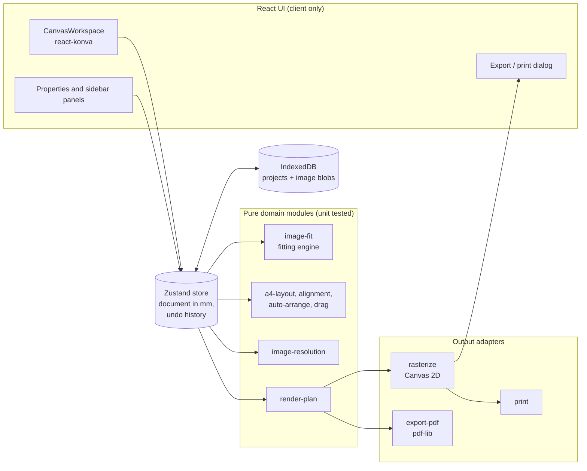

<div align="center">


# Sheetfit

**Exact-size print layouts on A4. Every design printed whole, at the size you typed.**

[](https://github.com/satyaidk/tool-bar/actions/workflows/ci.yml)


[](LICENSE)

[Overview](#overview) · [Features](#key-features) · [Architecture](#architecture) · [Getting started](#getting-started) · [Testing](#testing--quality) · [Design decisions](#design-decisions-adrs) · [Docs](#documentation)


</div>

## Overview

Sheetfit is a browser-based layout editor for sublimation transfers, T-shirt and mug prints, stickers, labels and PVC cards. You upload an image, type the physical size you need (for example 90 × 60 mm), and place it on an A4 sheet. The output is a print-ready PDF, PNG or JPEG in which every design has exactly that physical size and position.

General-purpose design tools usually treat a sized image frame as a crop window (`object-fit: cover`), which silently cuts off the edges of a logo when its proportions differ from the frame. Sheetfit does the opposite by default: the whole image is fitted inside the requested box, the proportions are preserved, and any leftover space is measured and reported. Distortion and cropping exist, but only as explicit, opt-in actions.

Everything runs in the browser. There is no account, no server and no upload: images and saved projects stay in the user's browser (IndexedDB).

## Key features

- **Non-cropping fitting engine.** Six modes: fit entire image (default), fit width, fit height, fill remaining space with a colour, manual scale, and stretch. Stretch requires confirmation; cropping is a separate switch that is off by default and never alters the source file.
- **Physical units throughout.** The document model is millimetres. Inputs accept mm, cm, inches or pixels (at the export DPI), with an aspect-ratio lock that derives the other side from the image.
- **A4 sheet tools.** Portrait and landscape, per-side margins, printable-area guides, millimetre rulers, snapping to the page centre, margins and other designs, optional grid snapping, and an option that keeps designs inside the margins.
- **Multiple designs per sheet.** Duplicate, copy and paste, multi-select, group, align, repeat a design in a grid ("fill sheet"), and auto-arrange mixed sizes without overlap. Layouts never resize anything; if designs do not fit, the editor says how many were left over and which change (orientation, spacing, margins) would help, checked by re-running the layout.
- **Print-quality checks.** Effective DPI for each design at its printed size, with high, acceptable and low bands, in the panel and before export.
- **Exports.** Exact-size A4 PDF (595.276 × 841.890 pt) with designs placed as vectors and PNG/JPEG sources embedded without recompression; PNG with transparency and JPEG at 150, 300 or 600 DPI with the DPI written into the file metadata.
- **Browser printing at actual size.** A print-only render with `@page { size: A4; margin: 0 }` and step-by-step guidance for the print dialog.
- **Local projects.** Save, reopen, duplicate and delete projects in IndexedDB, including the original image files, or export a portable `.sheetfit` project file to continue on another computer.

## Demo

| Editor | Export preview | Landing page |
| --- | --- | --- |
|  |  |  |

Run the app locally and open `/editor?sample` to load the same sample sheet: a square logo in a 90 × 60 mm box, a very wide wordmark, a 300 × 200 px photo that triggers the low-resolution warning, and a 50 mm sticker.

## Architecture



Three rules hold the design together:

1. **One coordinate system.** The document stores millimetres. Pixels and PDF points appear only at the edges, in [`coordinate-conversion.ts`](src/lib/layout/coordinate-conversion.ts), and rounding to whole pixels happens only when an export canvas is allocated.
2. **One render plan.** [`render-plan.ts`](src/lib/render/render-plan.ts) turns the document into plain data. The PNG, JPEG, PDF, print and preview paths all draw from it, so the export preview is the export.
3. **Pure rules, thin UI.** Fitting, layout, snapping, quality and export geometry are pure TypeScript with no React or DOM dependency, which is why they can be tested exhaustively in Node.

See [docs/design.md](docs/design.md) for the full design document.

## Getting started

### Prerequisites

- Node.js 20.9 or newer (developed on Node 24)
- npm 10 or newer
- A Chromium-based browser, Firefox or Safari

### Install

```bash
git clone https://github.com/satyaidk/tool-bar.git
cd tool-bar
npm ci
```

### Configure

No configuration or environment variables are required. The app has no backend and makes no network requests at runtime beyond loading its own assets.

### Run

```bash
npm run dev        # http://localhost:3000
npm run build      # production build
npm run start      # serve the production build
```

## Usage

1. Open `/editor`, then drop PNG, JPG or WebP files on the sheet or use **Upload images**. Each image is placed at its native size at 300 DPI, capped to the printable area.
2. Select a design and type the print size in **Print size**, or pick a preset such as 90 × 60 mm or 85.6 × 54 mm (ID-1 card). The panel states the size the image itself will print at and how much of the box stays empty.
3. Choose a fitting mode. **Fit entire image** is the default and never crops.
4. Position the design by dragging, with arrow keys (1 mm, Shift for 10 mm), with exact X/Y values, or with the alignment buttons.
5. For sticker sheets, use **Repeat on sheet** to fill the page with copies at a chosen spacing.
6. Click **Export** for PDF, PNG, JPEG or a `.sheetfit` project file, or **Print**. When printing from the browser, select A4, the matching orientation and 100% / actual size scaling.

Keyboard shortcuts are listed in the properties panel when nothing is selected.

## Project structure

```text
src/
  app/                    Next.js App Router pages (landing, /editor)
  components/
    editor/               Workspace, canvas nodes, rulers, toolbars, panels
    settings/             Measurement fields, size and fitting controls, page settings
    uploads/              Upload panel and thumbnails
    export/               Export and print dialog
    ui/                   shadcn/ui-style primitives on Radix
  lib/
    image/                Fitting engine, resolution checks, file decoding
    layout/               Units, A4 geometry, alignment, snapping, auto-arrange
    render/               Render plan shared by every output
    export/               Canvas rasteriser, PDF builder, DPI metadata, printing
    storage/              IndexedDB persistence
  store/                  Zustand editor store
  types/                  Document, image and project types
tests/                    Vitest unit tests
docs/                     Design document, ADRs, learning path, images
```

## Testing & quality

```bash
npm run lint           # ESLint (Next.js core-web-vitals + TypeScript rules)
npm run typecheck      # tsc --noEmit, strict mode
npm test               # Vitest
npm run test:coverage  # Vitest with V8 coverage and thresholds
npm run check          # all of the above plus a production build
```

The suite has 107 tests across fitting, units, layout, snapping, auto-arrange, the render plan, PDF export, DPI metadata, file validation, IndexedDB storage, project files and the editor store. It includes every scenario listed in the original specification, for example a square logo in a 90 × 60 mm box, an extremely wide logo, a low-resolution image at 300 DPI, A4 portrait and landscape PDFs, and an image placed at a known coordinate. A property-style test checks that no non-distorting mode ever places image pixels outside the box.

Coverage is measured over the domain, export and store layers (`src/lib`, `src/store`), excluding browser-only glue that needs a real DOM canvas: 86.7% of lines, 83.4% of statements and 71.9% of branches. CI enforces minimums of 80% lines, statements and functions and 65% branches.

Browser-only paths (Konva interaction, canvas export, file upload, IndexedDB round trip, printing) were verified end to end in headless Chrome against the production build. See [Evaluation](#evaluation).

## Evaluation

Measured in headless Chrome against `npm run build && npm run start`, on the sample sheet:

| Check | Result |
| --- | --- |
| PDF page size | 1 page, 595.276 × 841.890 pt = 210.000 × 297.000 mm |
| PNG export at 300 DPI | 2480 × 3508 px, pHYs chunk reads 300 DPI |
| Browser print image | 2480 × 3508 px rendered at 210 mm × 297 mm with `@page { size: A4 portrait; margin: 0 }` |
| Square logo in a 90 × 60 mm box | Prints at 60 × 60 mm, 15 mm spare each side, nothing cropped |
| Full-page PNG uploaded onto a 5 mm-margin sheet | Placed at 200 × 282.9 mm, whole, inside the 200 × 287 mm printable area |
| Drag, undo, typed sizes, save and reopen | Behave as expected; no console errors |
| `.sheetfit` export and re-import | Same designs restored with original image bytes |
| Mobile viewport (390 × 844) | No horizontal overflow |

## Design decisions (ADRs)

| ADR | Decision |
| --- | --- |
| [0001](docs/adr/0001-millimetres-as-the-document-unit.md) | Millimetres are the only unit stored in the document |
| [0002](docs/adr/0002-contain-by-default-never-crop.md) | Fit inside the box by default; distortion and cropping are opt-in |
| [0003](docs/adr/0003-shared-render-plan.md) | Every output draws from one shared render plan |
| [0004](docs/adr/0004-konva-for-the-editor-canvas.md) | Konva (react-konva) for interactive editing |
| [0005](docs/adr/0005-pdf-lib-vector-placement.md) | pdf-lib with vector placement for PDF export |
| [0006](docs/adr/0006-client-only-with-indexeddb.md) | Client-only app with IndexedDB persistence |

## Documentation

- [Design document](docs/design.md): goals, model, fitting rules, coordinate system, export pipeline, risks
- [Learning path](docs/learning-path.md): a guided reading order through the code for new contributors
- [Printing guide](docs/printing-guide.md): getting exact physical sizes on paper
- [Architecture decision records](docs/adr/)

## Roadmap

- Additional paper sizes (A3, Letter, custom sheets) on the same millimetre model
- Bleed and safe-area guides per design
- Multiple pages per project
- Mirror (flip) option for sublimation transfers that print reversed
- Rotate-to-fit in auto-arrange when a design fits only when turned 90°
- Browser end-to-end tests in CI (Playwright) for the canvas interactions verified manually today

## Contributing

Contributions are welcome. Read [CONTRIBUTING.md](CONTRIBUTING.md) for the development workflow, coding conventions and the checks a pull request must pass.

## Security

Sheetfit processes files locally and has no server. To report a vulnerability, follow [SECURITY.md](SECURITY.md).

## License

Released under the [MIT License](LICENSE).

## Acknowledgements

- [Next.js](https://nextjs.org/), [React](https://react.dev/) and [Tailwind CSS](https://tailwindcss.com/)
- [Konva](https://konvajs.org/) and [react-konva](https://github.com/konvajs/react-konva) for the canvas editor
- [pdf-lib](https://pdf-lib.js.org/) for PDF generation
- [Radix UI](https://www.radix-ui.com/) primitives in the style of [shadcn/ui](https://ui.shadcn.com/), and [Lucide](https://lucide.dev/) icons
- [Zustand](https://zustand.docs.pmnd.rs/), [idb](https://github.com/jakearchibald/idb) and [Vitest](https://vitest.dev/)
- The [Archivo](https://fonts.google.com/specimen/Archivo) typeface by Omnibus-Type
